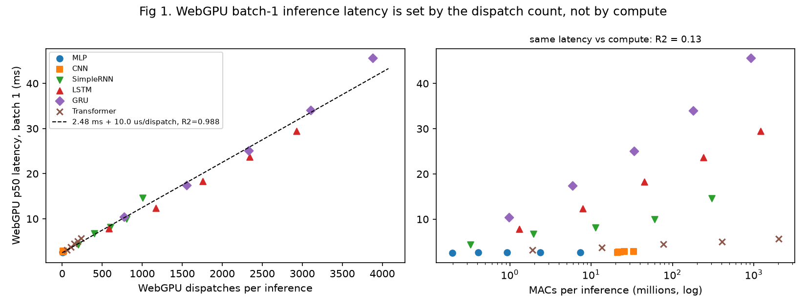
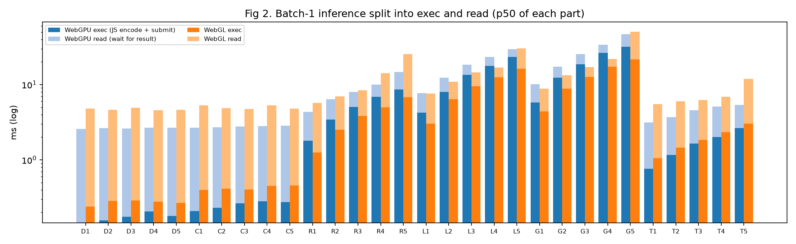
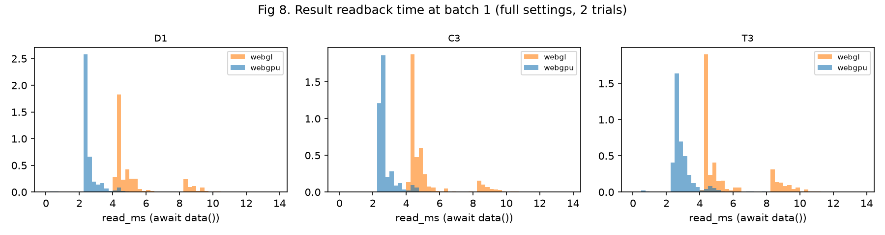
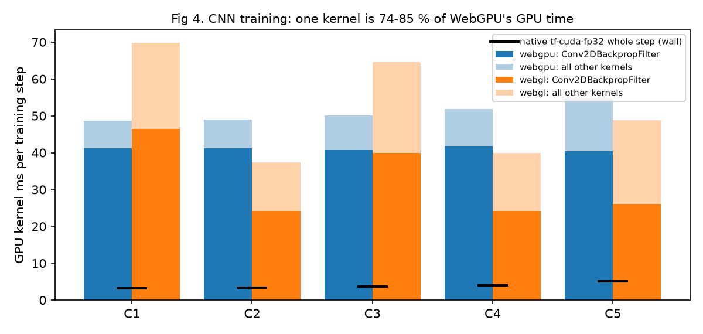
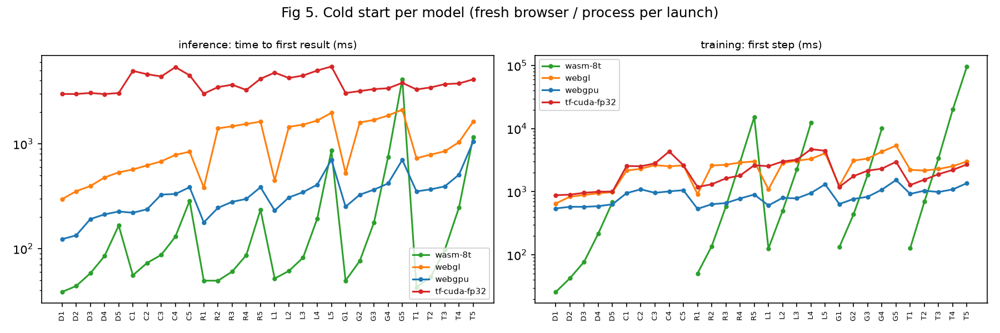
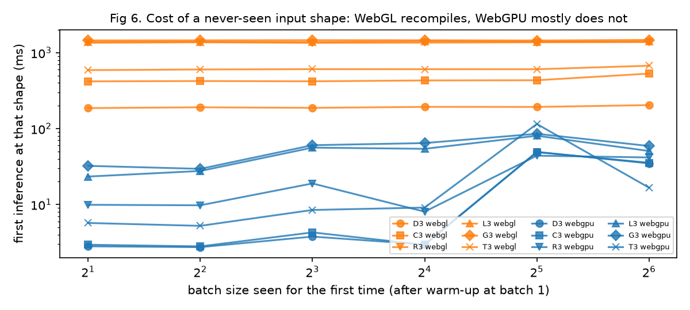
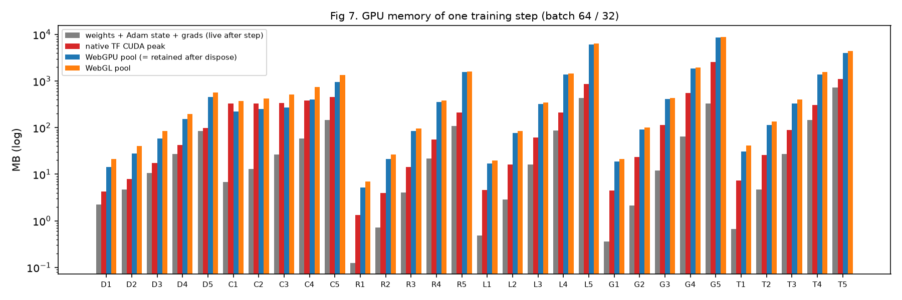
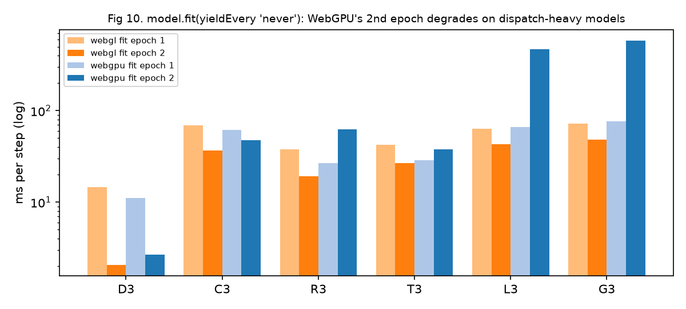
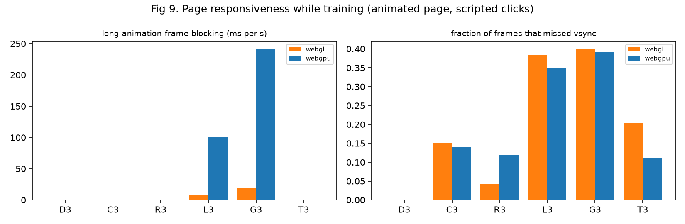

# Preliminary analysis: WebGPU for custom-model warm-up, inference and training in the browser

Status: **preliminary, not study data.** Every number here comes from the preflight and the development
validation runs of 12–13 Oct 2026. All of it is to be re-checked against the locked full run (3 trials, full
record counts) before it goes into the paper. Each finding states its data source and how strong it is.

Tables (CSV) are in `study_report/prelim/tables/`, figures in `study_report/prelim/figures/`. Both are
regenerated by `study_report/prelim/make_prelim.py`.

---

## 0. Setup and how to read the numbers

| Item | Value |
|---|---|
| Machine | RTX 3060 12 GB (driver 610.60), Windows 11, Chrome for Testing 157.0.8081.0 (D3D12 WebGPU, ANGLE-D3D11 WebGL) |
| Library | TF.js 4.22.0 (core, layers, backend-wasm / webgl / webgpu), each launch a fresh browser |
| Native reference | TF 2.10.1 / Keras, CUDA 11.2, cuDNN 8.1: `tf-cuda-fp32` (TF32 off; the parity reference), `tf-cpu` |
| Models | 30: MLP D1–D5, CNN C1–C5, SimpleRNN R1–R5, LSTM L1–L5, GRU G1–G5, Transformer T1–T5 (32 row tokens of 96 values) |
| Inference | batch 1 unless stated; trained weights; `predict` → `await data()` |
| Training | Adam, batch 64 (D, C) / 32 (R, L, G, T); one step = forward + backward + optimizer + `await loss.data()` |

Two per-record quantities appear throughout:

- **exec** is the time until TF.js returns control after issuing the work. On GPU backends this is the
  JavaScript cost of encoding and submitting kernels.
- **read** is the time spent in `await data()`, which includes waiting for the GPU to finish.

### Data sources

| Tag | Source | Strength |
|---|---|---|
| **[F]** | `dev_warmfloor/full` + `full2`: 13 models (D1, D3, C3, R3, L3, G2, T1, T3, ...), 2 trials, full settings (≥200 inference records / ≥20 training steps, ≥2 s windows) | strongest available |
| **[S]** | `dev_warmfloor/smoke` + `smoke2`: all 30 models, 1 trial, 20 measured records, warm-up floor on | good for ranking; CIs wide |
| **[P]** | `preflight`: all 43 stages, 1 trial, 2–10 records (before the warm-up floor) | only for large effects and counts |
| **[I]** | instrumented / profile launches: counters, `tf.profile` kernel times, Nsight Systems | counts are exact; timings are perturbed by the instrumentation |

Ratios are written as *WebGPU time / other time*, so a value below 1 means WebGPU is faster.

---

## 1. Summary of findings

| # | Finding (WebGPU-centred) | Key number | Data |
|---|---|---|---|
| 1 | Batch-1 WebGPU inference latency is a linear function of the **number of dispatches**; compute (MACs) explains almost nothing | latency = 2.48 ms + 10.0 µs × dispatches, R² = 0.988; MACs alone R² = 0.13 | S, I |
| 2 | WebGPU's latency floor (~2.45 ms) is the browser's **completion-notification delay**, not GPU work or transfer | D3: GPU busy 0.062 ms of 3.41 ms; 2.56 ms pass between the last GPU work and the JS result | I (Nsight), F |
| 3 | WebGPU is **slower than WebGL** on gated RNNs (LSTM, GRU) for inference and training, because its per-kernel JavaScript cost is 1.5–2.1× higher | L3 inference 1.20–1.26×, G2 1.29–1.33×; per-call CPU Add 11.2 vs 6.6 µs | F, S, I |
| 4 | CNN training on WebGPU is gated by **one naive kernel** (`Conv2DBackpropFilter`) | 74–85% of GPU time; 22.8 ms for a layer whose forward conv takes 0.19 ms (122×) | I |
| 5 | WebGPU is as fast as or **faster than native CUDA** where native has no fused kernel (SimpleRNN, GRU), and 3–15× slower where it does (LSTM via cuDNN, CNN, MLP) | R3 training 0.66× native; L2 training 8.8× | S, F |
| 6 | WebGPU's cold start beats WebGL's and native TF's by large factors, and its compiled pipelines **carry over across shapes and from training to inference** | time to first result 4–24× faster than native; WebGL recompiles every new batch size (0.19–1.47 s each) | S, P |
| 7 | WebGPU **training memory** is 3–7× native TF's peak for non-CNN models and is never released after `dispose()` | G5 8.6 GB pool vs 2.6 GB native; L5 6.1 GB vs 0.86 GB | P, S |
| 8 | The **Adam optimizer** is a large, hidden share of WebGPU training | 60–74% of GPU time on MLPs; T5 issues 1,222 optimizer kernels vs 829 forward | I |
| 9 | WebGPU's small-model training lead over WebGL **disappears without per-step sync** | D3 pipelined: WebGL 4.07 vs WebGPU 4.96 ms/step | P |
| 10 | `model.fit` without yielding makes WebGPU's 2nd epoch **7× slower** on dispatch-heavy models; WebGL is unaffected | L3 66 → 468 ms/step; renderer CPU-bound at ~1 core, GPU at 17% utilization | P |
| 11 | WebGPU training **blocks the page's main thread more than WebGL** on dispatch-heavy models | L3 long-animation-frame blocking 100 vs 7 ms/s; G3 242 vs 19 ms/s | S |
| 12 | WebGPU is the **most stable** browser backend (between-trial CoV ≤ 0.01) and keeps its latency under open-loop arrivals, unlike WebGL | WebGL service time ×2.9 at 5 req/s vs WebGPU ×1.3 | F, S |
| 13 | WebGPU numerics are **fp32-faithful** (≤4×10⁻⁶ vs CPU); native CUDA's default TF32 is 300× less accurate. There is one GPU-only outlier (R5 gradients) | native TF32 inference error 1.4×10⁻³; TF32 training gradients up to 4.4% off | P |
| 14 | A **GRU implementation detail** in tfjs-layers (it splits the recurrent weight matrix every timestep) dominates GRU cost on every backend and is catastrophic on WASM | G5 WASM 3.4 s vs L5 80 ms (42×) with 25% fewer MACs | S, I |

---

## 2. Findings in detail

### F1. WebGPU batch-1 inference is dispatch-bound, not compute-bound

**Observation.** Across all 30 models, the WebGPU p50 at batch 1 is predicted by the number of compute
dispatches alone (table `t2_latency_regression`):

| Backend | Predictor | R² | Fit |
|---|---|---|---|
| WebGPU | dispatches | **0.988** | 2.48 ms + 10.0 µs / dispatch |
| WebGPU | MACs | 0.128 | – |
| WebGPU | kernels + MACs | 0.981 | MAC term 0.8 µs per million MACs (negligible) |
| WebGL | draws | 0.775 | 4.67 ms + 6.9 µs / draw |
| WebGL | kernels + MACs | 0.875 | MACs add 5.1 µs per million MACs |
| WASM | kernels + MACs | 0.39 (0.82 without GRU) | compute-bound |

Concrete pairs on WebGPU:
- **T5 vs L1.** T5 does 2,027 M MACs in 234 dispatches and takes 5.7 ms. L1 does 1.3 M MACs (1,500× fewer) in 584 dispatches and takes 7.9 ms.
- **D1 vs D5.** D1 and D5 differ 37× in MACs and both take about 2.6 ms.

**Why.** At batch 1 the GPU is idle almost all the time. The profile's GPU-busy fraction per inference is
0.9–8.7% for MLPs, 3.5–16% for CNNs and 5–52% for Transformers, and Nsight shows 1.8% for D3. What costs
time is the JavaScript work per kernel (about 10 µs: shader-key lookup, one bind group created per dispatch,
a uniform-buffer write of about 104 bytes per dispatch, and encoding), plus a fixed readback floor (F2).
Recurrent models unroll 32 timesteps, so they issue 199–3,883 dispatches per inference against 5–14 for
MLPs and CNNs.

**Corner cases** (relative residuals of the fit).
- **Above the line:** the largest models with real GPU work, R5 (+17%, GPU busy 83%), T3–T5 (+14 to +19%, large matrix multiplies) and G5 (+10%, 84%). Here compute starts to show.
- **Below the line:** every LSTM (−6 to −13%), whose dispatches are mostly cheap element-wise kernels.
- **Elsewhere:** MLP and CNN residuals are within +2 to +10%, all at the readback floor.
- **On WebGL:** the same models show a size effect, because WebGL also pays per-texel costs (packing/unpacking).

**Implications.**
- On WebGPU in TF.js, "model cost" for interactive inference means kernel count. FLOP-based predictors and model-size intuitions mislead.
- Architectural choices that cut kernel count, such as fused recurrent cells, fewer timesteps or operator fusion, matter more than parameter count.
- In the paper, report dispatches per inference next to MACs for every model.

**Full-run check.** Refit with 3 trials and per-trial CIs. Repeat at batch 32 to test whether the R² falls as
GPU time grows.

---

### F2. WebGPU's 2.45 ms floor is the browser's completion-notification latency

**Observation.** For MLPs and CNNs, 89–95% of WebGPU's batch-1 latency is `read` (table `t1`):
exec 0.13–0.28 ms, read 2.43–2.56 ms [S]. With the full settings [F] the read p50 is 2.45–2.55 ms with a tight,
single-peaked distribution (table `t13`).

Nsight Systems [I] (table `t14`) shows where that time goes for D3:

| Capture | Page p50 | GPU busy per inference | Lead (start → first GPU work) | Tail (last GPU work → JS result) |
|---|---|---|---|---|
| D3 WebGPU inference | 3.41 ms | 0.062 ms (1.8%) | 0.74 ms | **2.56 ms** |
| L3 WebGPU inference | 24.7 ms | 4.76 ms (21%) | 0.78 ms | 2.28 ms |
| T3 WebGPU inference | 5.48 ms | 0.57 ms (10%) | 0.83 ms | 2.30 ms |
| D3 native tf-cuda-fp32 | 0.67 ms | 0.038 ms | 0.07 ms | 0.15 ms |
| L3 native tf-cuda-fp32 | 5.55 ms | 0.91 ms | 0.012 ms | 0.016 ms |

The tail is 2.28–2.56 ms in every WebGPU capture, inference and training alike, against 0.002–0.15 ms
natively on the same GPU.

The readback micro-benchmark [P] (table `t20`) separates the steps:
- A raw `copyBufferToBuffer` + `mapAsync` of 1 MB after the queue is drained takes 0.42 ms.
- Draining the queue itself (`onSubmittedWorkDone`) took 2.49 ms.
- TF.js `data()` on an already idle GPU takes 3.7 ms for 1 MB.

A 40-byte result costs the same 2.45 ms as 1 MB, so this is not transfer. In 0.1–0.8% of WebGPU reads the
result arrives in under 1 ms (minimum 0.34–0.57 ms), so the floor is not a hardware limit.

Comparison with the other paths (D3, batch 1) [F, P]:

| Path | p50 | Notes |
|---|---|---|
| WASM (8 threads) | 0.05 ms | no readback |
| WebGL + `dataSync` (sync `readPixels`) | 1.3 ms | read 0.66 ms, but blocks the main thread |
| **WebGPU + `data()`** | **2.64 ms** | read 2.45 ms, single peak |
| WebGPU + `dataSync` | 5.4 ms | goes through a canvas path; 123 MB/s at 64 MB vs 3,040 MB/s for `data()` |
| WebGL + `data()` | 4.70 ms | read 4.45 ms, **two peaks**: 15% of reads at 8.5–9.5 ms (setTimeout-polled fence) |

**Why (interpretation).** The cost is the time for the GPU process to observe that the submitted work has
finished and report that to the renderer. A fixed delay of about 2.4 ms after submission, rare fast
completions and the drain step costing the same are all consistent with periodic polling of completion in
Chrome's GPU process. This is a hypothesis; confirming the polling interval needs Chromium source or a
trace.

**Corner case.** WebGPU's *synchronous* read is worse than WebGL's (5.4 vs 1.3 ms), and for large tensors
`dataSync` on WebGPU is 25× slower in throughput than `data()`. The common advice to use `dataSync` for
latency is wrong on WebGPU.

**Implications.**
- For small interactive models the browser's completion path, not the GPU, sets WebGPU's latency, and a 40-byte answer costs 2.45 ms.
- Requests should be batched or pipelined. Single-request latency will not improve with faster GPUs.
- A browser-side change, such as faster completion delivery, would lift all small-model WebGPU workloads.

**Full-run check.** `readback_micro` with full repetitions. Correlate the tail with the GPU process's polling
using a Chrome trace in `gpu_trace`.

---

### F3. WebGPU vs WebGL: WebGPU loses on gated RNNs because each kernel costs more JavaScript

**Observation** (table `t1`, `t4`, `t5`; [S], confirmed on the [F] subset):

| Family | Inference WebGPU/WebGL (B=1) | Training WebGPU/WebGL |
|---|---|---|
| MLP | 0.53–0.59 | 0.54–0.77 |
| CNN | 0.50–0.59 | **1.09–1.16** (F4) |
| SimpleRNN | 0.58–0.96 | 0.77–1.17 |
| LSTM | **1.01–1.39** (L1–L4), 0.98 (L5) | **1.22–1.49** (L1–L3), 0.93 / 0.67 (L4 / L5) |
| GRU | **1.13–1.54** (G1–G4), 0.90 (G5) | **1.20–1.33** (G1–G3), 1.00 / 0.74 (G4 / G5) |
| Transformer | 0.48–0.73 | 0.52–1.14 |

With the full settings [F], L3 inference is 17.47 vs 14.51 ms (1.20×) and G2 is 17.62 vs 13.25 ms (1.33×).
L3 training is 64.2 vs 48.8 ms per step (1.32×) and G2 training is 49.6 vs 38.0 ms (1.31×). Between-trial CoV is
≤ 0.06, so this is not noise.

**Why** [I] (table `t3`). The WebGPU loss comes from `exec`, the JavaScript side. L3 exec is 12.65 ms on
WebGPU against 9.59 ms on WebGL [F]. Per call, WebGPU's host CPU cost is higher on the small element-wise
kernels that dominate unrolled RNN cells:

| Kernel | Calls (30-model profile) | WebGL µs/call | WebGPU µs/call | Ratio |
|---|---|---|---|---|
| Add | 5,505 | 6.6 | 11.2 | 1.69 |
| Sigmoid | 2,400 | 3.7 | 7.9 | 2.12 |
| Neg | 480 | 4.8 | 8.7 | 1.81 |
| Tile | 60 | 9.2 | 17.5 | 1.91 |
| _FusedMatMul | 3,425 | 9.0 | 13.2 | 1.46 |
| SplitV | 1,920 | 15.5 | 24.3 | 1.57 |

Per model, WebGPU's CPU µs per kernel exceeds WebGL's by 1.2–1.6× for R, L and G, and is 0.54–0.90× of
WebGL's for D, C and T, whose few kernels are heavy. Each WebGPU dispatch also creates a bind group
(training: bind groups created = dispatches, table `t6`) and writes a uniform buffer.

The GPU is not the limit: on WebGPU, L3 is GPU-busy only 21% of each inference (Nsight).

**A simple crossover model.** Using the two fits from F1 (WebGPU 2.48 ms + 10.0 µs per dispatch; WebGL 4.67 ms
+ 6.9 µs per draw), the lines cross at about **714 kernels**. Below that, WebGPU's lower readback floor wins;
above it, WebGL's cheaper per-kernel cost wins until GPU time dominates.
- This predicts the observed pattern: WebGPU wins for D, C and T (≤ 234 dispatches), it's a tie around R2–R3 and L1 (400–600), and WebGL wins from G1/L2 up (775+).
- At the largest sizes (L5, G5) GPU time takes over, and WebGPU's faster kernels win again.

**Implications.**
- WebGPU is not uniformly the fastest browser backend. For sequential, kernel-heavy models, its per-dispatch host overhead in TF.js outweighs its better readback.
- Fused cell kernels (one dispatch per LSTM or GRU step) would remove the problem. That is an engineering gap in TF.js's WebGPU backend, not in WebGPU itself.

---

### F4. CNN training on WebGPU is held back by one naive kernel

**Observation.** WebGPU CNN training takes 47.9–55.0 ms per step for **every** CNN, from C1 (0.6 M parameters) to
C5 (12.7 M) [S]. That is 1.09–1.16× slower than WebGL and 10.6–15.3× slower than native (3.1–5.2 ms). 91–94% of
the step is `read`, i.e. waiting for the GPU.

The training profile [I] shows that `Conv2DBackpropFilter` (the weight gradient) takes 40.4–41.2 ms per step,
74–85% of all GPU kernel time:

| Layer (all CNNs share it) | Forward Conv2D | Conv2DBackpropFilter | Ratio |
|---|---|---|---|
| conv_0: 32×32×3 → 64, batch 64 (113 M MACs) | 0.187 ms | **22.8 ms** | **122×** |
| conv_1: 16×16×64 → 128 (1.21 G MACs) | 0.68–0.94 ms | 17.6–18.8 ms | 20–27× |

**Why** (source: `tfjs-backend-webgpu/dist/conv_backprop_webgpu.js:202-258`, `kernels/Conv2DBackpropFilter.js`).
TF.js's WebGPU weight-gradient kernel launches one thread per filter element and loops serially over
batch × output height × output width. For conv_0 that is 3×3×3×64 = **1,728 threads** (27 workgroups of 64, on a
28-SM GPU), each doing **65,536** serial multiply-adds. The input-gradient kernel already has a matrix-multiply
variant (`Conv2DDerInputMMProgram`); the weight gradient has none.

The cost grows linearly with batch, because the loop runs over the batch. From batch 16 to batch 256, C3
WebGPU goes from 15.7 to 184.8 ms per step (11.8×), while native goes from 2.2 to 9.0 ms (4×) [S].

**Corner case.** WebGL's weight gradient is also slow (16–29 ms for conv_0), but its conv_1 weight gradient is
faster (8–17 ms), so WebGL wins overall.

**Estimate (not measured).** With a matrix-multiply weight gradient as fast as WebGPU's forward conv, the C3
step would fall from about 50 ms to about 9–10 ms, making WebGPU about 4–5× faster than WebGL.

**Implications.**
- WebGPU training readiness depends on how good each backward kernel is, not on forward performance.
- Inference benchmarks overstate how ready a backend is for training.
- One kernel rewrite would change the CNN training conclusion.

---

### F5. WebGPU vs native CUDA: the gap depends on whether native has a fused kernel

**Observation** (table `t5` geomeans; per-model `t1`, `t4`):

| Family | Native kernel for the recurrent / main op | Inference WebGPU/native | Training WebGPU/native |
|---|---|---|---|
| SimpleRNN | none (generic while loop) | 0.86–0.97 (R3–R5) | **0.66–0.99** (R2–R5) |
| GRU | none (`reset_after=False` is not cuDNN-eligible; recorded per launch) | 1.10–1.72 | 0.91–1.36 |
| LSTM | cuDNN | 1.87–5.75 | 2.96–8.79 |
| MLP | cuBLAS | 4.3–5.9 | 2.8–4.2 |
| CNN | cuDNN | 3.4–3.8 | 10.6–15.3 |
| Transformer | cuBLAS | 1.75–3.71 | 1.9–5.0 |

WebGPU is faster than native TensorFlow on SimpleRNN training. For R3 it's 27.7 vs 42.2 ms per step [S].

**Why.** Native TensorFlow runs non-fused RNNs as a graph loop with per-step op launches, and pays per-op host
costs too. Where cuDNN or cuBLAS fuse the work, native wins by large factors.

Nsight [I] also shows that WebGPU's kernels do more GPU work for the same math:
- L3 training: 22.7 ms of GPU time per step on WebGPU vs 4.1 ms natively (5.5×).
- T3 training: 11.4 vs 6.4 ms (1.8×).
- D3 training: 1.07 vs 0.23 ms (4.6×).

So the gap is not only host overhead.

**Implications.**
- A browser-versus-native gap only means something if the native kernels are named. Here the "native gap" is largely a cuDNN or cuBLAS gap.
- For models the frameworks don't fuse, WebGPU in the browser is already at native parity.
- The paper should report `native_cudnn_rnn` next to every RNN comparison, as the harness does.

---

### F6. Cold start: WebGPU starts faster than WebGL and native, and its pipelines transfer

**Time to first result** (inference: backend init + model build + weights + first run) [S], table `t8`:

| | WASM | WebGL | **WebGPU** | native tf-cuda-fp32 |
|---|---|---|---|---|
| range over 30 models | 39–4,137 ms | 296–2,118 ms | **123–1,050 ms** | 2,980–5,463 ms |
| backend init | 22–29 ms | 5–8 ms | 23–30 ms | 2,218–2,731 ms |

Ratios:
- WebGPU reaches the first result 3.9–24× sooner than native TF CUDA, whose first run includes `tf.function` tracing.
- WebGPU is 1.6–5.7× sooner than WebGL on every model: 1.6–2.6× for MLP, CNN and Transformer, and 4.1–5.7× for the recurrent models of size ≥ 2 (R2: 245 vs 1,404 ms; G2: 327 vs 1,600 ms).
- WASM is fastest for small models (39–98 ms).

The first training step on WebGPU takes 0.54–1.53 s. That is 1.4–4.9× faster than natively (0.88–4.72 s), and
faster than WebGL's 0.65–5.39 s.

**Why.**
- **Fewer programs.** WebGL links 2.2–2.9× more programs than WebGPU creates pipelines for the same model (table `t9`: e.g. L3 43 vs 19, T3 67 vs 26), because WebGL bakes shapes into its shaders.
- **One expensive shader on WebGL.** WebGL's cold start jumps about 1 s between sizes 1 and 2 of every recurrent family (R1 367 → R2 1,388 ms). The only new kernel type at size 2 is a single `Pack`, the stacking of 32 timestep outputs for a sequence-returning layer. WebGPU's first run rises by just 68 ms over the same step. The ~1 s is most likely the compile of that one many-input shader on WebGL. That's a hypothesis: the per-program compile time isn't measured yet.

**Shape reuse** [S] (table `t10`):
- **WebGL:** every never-seen batch size costs a full recompile, 186 ms (D3) to 1.47 s (G3) each time, about its own cold start.
- **WebGPU:** a new batch size of 2–16 costs about the same as a steady inference (D3 2.7–3.8 ms; L3 23–55 ms). Batch 32 and 64 cost 8–27× steady, which suggests TF.js switches kernel variants at larger sizes. This is confounded: batch 32 was also the first new shape in the seeded sequence.

**Phase transfer** [P] (table `t11`). After a training session, the first inference on WebGPU is 2.8–3.6×
faster than a cold one for R, L, G and T (L3: 84 vs 293 ms), and 1.4–1.5× for D and C. On WebGL the gain is only
1.0–1.4×. The other direction gives little on either backend (WebGPU 1.07–1.34×, WebGL 0.92–1.12×), because the
backward pass and optimizer need pipelines that inference never creates.

**Mitigations** [P]:
- **Precompile.** WebGPU's compile-only pass costs 52–96 ms, cuts the first run 9–46× and halves time to first result (0.41–0.50×). On WebGL the precompile pass itself takes 107–1,056 ms.
- **Training precompile.** After it, the first training step drops from 576 to 14.8 ms (D3, 39×), so a cold training step is almost entirely pipeline creation.
- **Shader disk cache** (returning user). WebGPU's first run falls to 24–60 ms (5–6×), WebGL's to 49–136 ms (8–12×).

**Implications.**
- WebGPU's shape-agnostic pipelines suit dynamic shapes (variable batch sizes, online fine-tuning in the page) much better than WebGL.
- A training session pre-warms later inference.
- For cold-start-sensitive apps, the ranking is WASM (small models) < WebGPU < WebGL ≪ native.

---

### F7. WebGPU training memory: 3–7× native, and never released

**Observation** [P, S] (table `t12`). For one training step:

| Model | Weights + Adam + grads (MB) | Native CUDA peak (MB) | **WebGPU pool (MB)** | WebGPU / native | Pool / live state |
|---|---|---|---|---|---|
| D3 | 10.5 | 17.4 | 58.3 | 3.4× | 5.5× |
| L3 | 16.2 | 61.4 | 321 | 5.2× | 19.8× |
| L5 | 437 | 858 | **6,102** | 7.1× | 14.0× |
| G5 | 328 | 2,581 | **8,566** | 3.3× | 26.1× |
| R5 | 109 | 211 | 1,558 | 7.4× | 14.3× |
| T5 | 722 | 1,110 | 3,956 | 3.6× | 5.5× |
| C3 | 26.4 | 342 | 273 | **0.80×** | 10.3× |

The WebGPU pool after `dispose()` of every tensor equals the pool during training for every model (column
`webgpu_retained_after_dispose_mb`). The memory stays with the page.

For inference, WebGPU's pool is 1.0–1.3× the weights for every model above 1 MB of weights (up to 2.8× for the
tiniest), tighter than WebGL's 1.5–9.6×. It is below native's peak for most models (0.02–1.9×).

**Why.** Eager autodiff keeps every intermediate of all 32 unrolled timesteps until the backward pass, and
TF.js's buffer manager keeps freed buffers in its pool for reuse. CNNs are the exception: native TF reserves a
cuDNN workspace (~160 MB) that TF.js doesn't need.

**Implications.**
- On 4–8 GB laptop GPUs, browser training of L5, G5 or T5-sized recurrent or attention models will hit memory limits long before compute limits.
- A page that trains once holds its peak (up to 8.6 GB here) until the tab closes, shared with every other tab's GPU use.
- Gradient checkpointing or truncated backpropagation through time would be needed for in-browser RNN training at scale.

---

### F8. Adam is a hidden third of WebGPU training

**Observation** [I] (table `t6`):
- **MLPs:** the optimizer's kernels are 60–74% of WebGPU GPU kernel time (D1–D5). Forward plus backward is only 0.16–1.2 ms.
- **Transformers:** the optimizer issues more kernels than the forward pass (T5: 1,222 optimizer vs 829 forward vs 875 backward). It's the largest CPU phase for T1–T4 (4.0–13.1 ms per step).
- **Recurrent models:** only 3–8% of GPU time is optimizer, since forward and backward dominate.

Six kernels per step are forwarded to the CPU on both GPU backends (2 in backward, 4 in the optimizer: scalar
Adam bookkeeping). Disallowing them (strict mode) costs nothing measurable: D3 5.66 vs 5.90 ms, L3 65.5 vs
67.5 ms [P].

**Why.** TF.js Adam updates each variable with about 14 separate element-wise kernels. Transformers have many
small variables (LayerNorm γ/β and Q/K/V/O biases per block).

**Implication.** A fused, multi-tensor Adam kernel would cut WebGPU dispatches per step by roughly 20–44% for
Transformers and up to 60% for MLPs. Given F1, dispatch count is what matters on WebGPU.

---

### F9. WebGPU's small-model training lead depends on per-step synchronization

**Observation** [P, one window per pair: to be confirmed] (table `t19`):

| D3 training | per-step sync (`await loss.data()`) | pipelined (10 steps per sync) | `model.fit`, no sync (epoch 2) |
|---|---|---|---|
| WebGL | 7.72 ms | 4.07 ms (−47%) | **2.07 ms** |
| WebGPU | 5.90 ms | 4.96 ms (−16%) | 2.65 ms |

The step's `read` share on WebGPU is 54–66% for MLPs [S]. Once the per-step sync is removed, WebGL becomes
faster than WebGPU on D3.

Submit batching: submitting after every dispatch (`sb1`) slows WebGPU training 1.3–4.0× (C3 1.26×, L3 269 vs
67.5 ms per step) and recurrent-model inference 3.7–5.3× (R3, L3, G3). A batch of 64 dispatches per submit is
within −9%…+6% of the default 15.

**Implication.** WebGPU's training advantage over WebGL on small models is mostly a readback-floor
advantage (F2). Any WebGPU vs WebGL comparison must state its sync policy.

---

### F10. `model.fit` without yielding: WebGPU's second epoch is up to 7.6× slower

**Observation** [P, one launch per pair] (table `t16`). `fit` with `yieldEvery: 'never'` and no callbacks (no reads
inside an epoch):

| Model (dispatches per step) | WebGPU epoch 1 → 2 (ms/step) | WebGL epoch 1 → 2 | WebGPU epoch 2: GPU util / SM clock | Renderer CPU in epoch 2 |
|---|---|---|---|---|
| G3 (5,803) | 76 → **582** (7.6×) | 72 → 48 | 21% / 465 MHz | 97.6 s over 93.1 s |
| L3 (5,140) | 66 → **468** (7.1×) | 63 → 43 | 17% / 485 MHz | 77.6 s over 74.9 s |
| R3 (1,975) | 27 → 63 (2.4×) | 38 → 19 | 16% / 1,237 MHz | 11.6 s over 10.0 s |
| T3 (1,271) | 29 → 38 (1.3×) | 42 → 27 | 23% | – |
| C3, D3 (≤ 255) | faster in epoch 2 | faster | – | – |

GPU memory stays flat (1.2–1.4 GB). The renderer's CPU time per step rises from 84 ms to 485 ms for L3 (5.8×).
The GPU starves and the driver drops its clock.

**Interpretation (hypothesis).** The slowdown grows with the amount of WebGPU work issued without the page ever
yielding to its event loop. Severity tracks dispatches per step, and WebGL is unaffected.

TF.js's own pending-disposal lists are cleared every 15 dispatches (`backend_webgpu.js:193-206`), so the growth
is probably in the browser's WebGPU client or renderer. The custom loop awaits the loss every step and never
shows this.

**Full-run check.** Run `fit` with `yieldEvery: 'auto'` vs `'never'` and 1–4 epochs, with a Chrome CPU profile of
the renderer.

**Implication.** Long synchronous WebGPU command streams from the main thread are hazardous. Frameworks and
apps should yield or sync periodically.

---

### F11. "WebGPU is asynchronous" does not mean the page stays responsive

**Observation** [S] (table `t15`; 100 Hz display, animated page, scripted clicks):

| Training | Long-animation-frame blocking (ms/s), WebGL → WebGPU | Missed vsync, WebGL → WebGPU | Click delay p50, WebGL → WebGPU |
|---|---|---|---|
| L3 | 7.1 → **100.2** | 0.38 → 0.35 | 0.34 → **5.2 ms** |
| G3 | 19.1 → **241.8** | 0.40 → 0.39 | 19.4 → 34.9 ms |
| D3, T3, C3 | 0 → 0 | ≤ 0.20 on both | < 14 ms |

WebGPU *inference* keeps frames on time (0 missed, except G3 at 3%). WASM training freezes the page outright
(L3: 2.0 s click delay; frames at 1–2 per second).

A corner case: WASM *inference* drops 47–49 frames per second even for 0.05 ms inferences (frame p95 90 ms). The
inference loop on WASM leaves too few frame slots, which is likely the multi-threaded runtime occupying the main thread.

**Why.** WebGPU's API is asynchronous, but encoding 5,000+ dispatches per step is synchronous JavaScript on
the main thread (F3), and it costs more per dispatch than WebGL.

**Implication.** UIs that train in-page should run TF.js-WebGPU in a worker. The same applies to
dispatch-heavy inference (G3 click delay p95 15 ms).

---

### F12. Stability and load: WebGPU is the predictable backend

**Steady-state stability** [F] (2 trials, ≥ 200 records):
- **Between-trial CoV:** WebGPU 0.001–0.009 on all 7 inference models. WebGL 0.005–0.059. WASM up to 0.19 (L3), with 0.10–0.13 on D1/D3/G2.
- **Training tail ratio (p99/p50):** WebGPU 1.12–1.35 on recurrent and Transformer models, WebGL 1.37–1.55.
- **WebGL's tail:** it is set by its two-peak readback (F2). The p95 sits at about 9 ms, i.e. two fence-poll periods.

**Open-loop load** [S, P] (Poisson arrivals, 100 ms SLO; `benchmark_results/*/analysis/load/`):

| D3 at 5 req/s | Closed-loop p50 | Service time under load | Inflation |
|---|---|---|---|
| WebGPU | 2.64 ms | 3.36 ms | 1.27× |
| WebGL | 4.70 ms | 13.8 ms | **2.9×** |

WebGL's results also changed between runs: L3 at 5 req/s missed 22% of deadlines in the preflight and 0% in
the validation run. WebGPU's did not change. Low arrival rates leave the GPU idle between requests, which pushes
WebGL into its slow idle-GPU fence regime (P0.6).

At 50 req/s, WebGPU still serves C3, D3, R3 and T3 with no misses. On L3 it delivers 23.5–36.5 of 48.5 req/s,
where WebGL delivers 0.5–5.5.

**Implication.** For services with sparse requests, WebGPU's latency is a property of the model. WebGL's
depends on the arrival pattern.

---

### F13. Numerics: WebGPU is fp32-faithful; native's default is not

[P] tables `t21`–`t23`.

**Inference vs the TF.js CPU reference.** WebGPU, WebGL and WASM all stay within max |error| ≤ 4.1×10⁻⁶, with top-1
agreement 100% and top-5 overlap 100%. Native `tf-cuda` (TF32 on, the default) reaches 1.4×10⁻³ (about 300×
larger) and drops top-5 overlap to 0.994. Native `tf-cuda-fp32` matches at 1.5×10⁻⁷.

**Training, first-step gradient** vs native tf-cpu with TF.js's Adam formula:
- WebGPU's relative error is ≤ 1.7×10⁻⁶ on 26 of 30 models.
- C1 (2.2×10⁻⁵) and T4/T5 (≤ 9.7×10⁻⁵) are the same on native fp32 CUDA, so they reflect the reduction size, not the backend.
- Native TF32 gradients are off by 1–4.4% (`tf-cuda+tfjsadam`).

**Corner case: R5.** WebGPU *and* WebGL deviate by 1.4×10⁻³ in the gradient (loss 3.4×10⁻⁴ after 3 steps), while
WASM matches the CPU (8.7×10⁻⁷). L5 and G5, of similar size, stay at 1.7×10⁻⁶.

R5 is a 5-layer, 1,024-unit SimpleRNN. Its recurrence has no gate to damp errors, so a different summation order in
the GPU matrix multiply (tiles shared by both GPU backends) can be amplified over 32 steps. This is a
hypothesis; the full run's 20-step correctness stage will show whether it grows.

**Implication.**
- WebGPU training in TF.js is numerically on par with CPU fp32.
- "Native" comparisons must pin fp32 (as `tf-cuda-fp32` does). The default TF32 changes both speed and the result.

---

### F14. GRU in tfjs-layers splits its weight matrix every timestep

**Observation.**
- **WASM** [S]: GRU inference costs 111 ms (G3), 596 ms (G4) and 3,400 ms (G5), against 5.7, 13.4 and 80 ms for LSTM of the same width. G5 has 25% fewer MACs than L5 yet is 42× slower.
- **CPU** [S]: native tf-cpu shows a smaller gap (G5 393 vs L5 87 ms).
- **WebGPU** [I]: `SplitV` is 41% of GPU kernel time for G5, and steady GRU inference creates 34–167 new GPU buffers each time (LSTM: 2–6).

**Why** (source: `tfjs-layers/dist/layers/recurrent.js:900-907`). `GRUCell.call` does
`tfc.split(recurrentKernel, [2·units, units])` at **every timestep**, copying the whole recurrent weight matrix
(8 MB per layer for G5). That's 3 splits per step × 32 steps × layers, i.e. 288 `SplitV` per G3 inference against
96 for L3, whose splits act on the small gate output.

On WASM, the matrix multiply that follows is about 60× slower per MAC for G5 than for L5 (4.85 ms vs 0.16 ms per
call). That's consistent with XNNPACK re-packing weights for every fresh slice, a hypothesis to test with a
pre-split ablation.

**Implication.** "GRU vs LSTM" or "WASM vs WebGPU on GRU" comparisons in TF.js partly measure this library
detail. The paper should present GRU results with this caveat, and could include a pre-split GRU ablation.

---

## 3. By backend (WebGPU first)

**WebGPU**
- **Strengths:**
  - lowest async readback floor of the GPU paths (2.45 ms);
  - fastest cold start among GPU paths (123 ms–1.05 s to first result);
  - shape-agnostic pipelines, so cheap new shapes and training → inference warm-up transfer;
  - tight inference memory (pool ≈ weights);
  - most stable (CoV ≤ 0.01), robust under open-loop load;
  - fp32-faithful numerics;
  - beats native TF where native has no fused kernel.
- **Weaknesses:**
  - batch-1 latency set by dispatch count (10 µs each) plus a 2.4 ms notification floor; the GPU is idle 80–99% of a small-model inference;
  - higher per-kernel JavaScript cost than WebGL, so it loses on gated RNNs;
  - a naive CNN weight-gradient kernel;
  - training memory 3–7× native, never released;
  - main-thread blocking during dispatch-heavy training;
  - `fit` slows down sharply in long non-yielding loops;
  - `dataSync` is a trap (5.4 ms, 123 MB/s).

**WebGL** (context)
- Async readback floor 4.45 ms with a second peak at ~9 ms.
- Synchronous `readPixels` is the fastest GPU readback (0.66 ms) but blocks the main thread.
- Cheaper per kernel than WebGPU.
- Recompiles for every new shape (0.19–1.47 s).
- About 1 s extra cold start for sequence-returning recurrent layers.
- Latency sensitive to arrival rate.
- Wins on gated-RNN B=1 inference (L1–L4, G1–G4) and on pipelined small-model training.

**WASM** (context)
- Best for batch-1 inference of small models: up to 86× faster than WebGPU on MLPs, 3–13× on CNNs, and ahead up to L4 and T3.
- Fastest cold start for small models.
- Unusable for training beyond toy sizes: T5 97 s per step, and WebGPU is 100–600× faster on the large models.
- Its 8 threads give no training speedup at all (1 thread = 8 threads within ±3%), while inference gains up to 7.3× (C3). The backward kernels are effectively single-threaded.
- CNN training is unsupported (no `Conv2DBackpropFilter`), and L5/G5 training exhausts its 4 GB heap.

**Native TF 2.10 CUDA** (reference)
- 3–15× faster where cuDNN or cuBLAS apply.
- On par with or slower than WebGPU for non-fused RNNs.
- Cold start 3–5.5 s (TF init alone 2.2–2.7 s).
- TF32 default costs accuracy.

---

## 4. By model family (where WebGPU wins and loses)

| Family | Best browser backend, B=1 inference | Best browser backend, training | WebGPU vs native (inf / train) | Main WebGPU limiter |
|---|---|---|---|---|
| MLP | WASM (10–86× vs WebGPU) | WebGPU (sync) / WebGL (pipelined) | 4.3–5.9 / 2.8–4.2 | readback floor; Adam kernels |
| CNN | WASM (3–13×) | WebGL (1.09–1.16×) | 3.4–3.8 / 10.6–15.3 | naive `Conv2DBackpropFilter` |
| SimpleRNN | WASM up to R4; WebGPU ≈ WASM at R5 | WebGPU at R1, R5; WebGL R2–R4 | 0.86–1.71 / 0.66–1.55 | dispatch count |
| LSTM | WASM up to L4, WebGPU at L5 | WebGL L1–L3, WebGPU L4–L5 | 1.9–5.8 / 3.0–8.8 | per-dispatch JS; memory |
| GRU | WebGL G2–G4 (WASM pathological) | WebGL G1–G3, WebGPU G5 | 1.1–1.7 / 0.91–1.36 | per-step weight split; memory |
| Transformer | WASM T1–T3, WebGPU T4–T5 | WebGPU (0.52–0.86× WebGL, except T2) | 1.75–3.7 / 1.9–5.0 | optimizer kernels |

At batch 256 (inference, [S]), WebGPU has the best per-sample time in every family except MLP, where WASM keeps a
slight edge (D3: 0.011 vs 0.013 ms per sample). There it is within 1.2× of native for T3 and 1.6–3.6× otherwise.

---

## 5. Corner cases and anomalies (to keep in the paper, not smooth over)

| Case | What happens | Explanation status |
|---|---|---|
| G1–G5 on WASM | 0.2–3.4 s per inference (up to 77× slower than WebGPU) | mechanism confirmed in source; WASM re-packing is a hypothesis |
| C1–C5 training on WebGPU | flat ~50 ms regardless of size; slower than WebGL | confirmed (source + per-kernel profile) |
| WebGL recurrent cold start, size 1 → 2 | +1 s | one `Pack` kernel is the only new op; compile cost is a hypothesis |
| WebGPU new shapes at batch 32/64 | 8–27× steady (others ≈ 1×) | order and size confounded; needs a shuffled shape order |
| `fit` epoch 2 on WebGPU (L3, G3) | 7× slower; renderer CPU-bound; GPU at 465 MHz | hypothesis (non-yielding stream); needs a test |
| R5 gradients on both GPU backends | 1.4×10⁻³ vs ≤ 1.7×10⁻⁶ for others | hypothesis (GPU matmul summation order × ungated recurrence) |
| WebGPU reads under 1 ms (0.1–0.8%) | proves the 2.4 ms floor is not inherent | supports the polling interpretation |
| WebGL `dataSync` faster than WebGPU `data()` | 1.3 vs 2.64 ms (D3) | sync `readPixels` avoids the fence poll; blocks the thread |
| WASM 1 thread = 8 threads in training | ±3% on all models | backward kernels effectively single-threaded |
| Native GRU inference memory | G5 1.8 GB peak at batch 1 (WebGPU 126 MB) | Keras generic GRU loop; to be checked |
| Native CNN memory > WebGPU | 326–386 MB vs 222–401 MB (C1–C4 training) | cuDNN workspace |
| Browser GPU power with no GPU work | 22–29 W during WASM windows vs 12 W idle | browser compositor keeps the GPU out of its lowest state; affects energy baselines |

---

## 6. Energy (per inference / per step, GPU board only) [F]

Source: table `t17` (NVML, windows ≥ 2 s, idle baseline 11.5–12.8 W).

| | WebGPU | WebGL | native tf-cuda-fp32 | WebGPU/WebGL | WebGPU/native |
|---|---|---|---|---|---|
| D1 inference | 63.9 mJ | 130.1 mJ | 16.1 mJ | 0.49 | 4.0 |
| C3 inference | 76.5 mJ | 143.3 mJ | 27.4 mJ | 0.53 | 2.8 |
| T3 inference | 126.2 mJ | 184.8 mJ | 72.1 mJ | 0.68 | 1.75 |
| L3 inference | 599 mJ | 398 mJ | 143 mJ | **1.51** | 4.2 |
| G2 inference | 492 mJ | 291 mJ | 429 mJ | **1.69** | 1.15 |
| D3 training step | 157 mJ | 211 mJ | 70 mJ | 0.74 | 2.2 |
| L3 training step | 3,266 mJ | 2,884 mJ | 693 mJ | 1.13 | 4.7 |
| T3 training step | 1,702 mJ | 2,428 mJ | 865 mJ | 0.70 | 2.0 |

Energy follows time, with one twist. On dispatch-bound models, WebGPU keeps the GPU at a higher clock than WebGL
(L3: 1,783 vs 1,453 MHz; 32.9 vs 26.3 W) while doing the same work more slowly. So WebGPU costs 1.5–1.7× WebGL's
energy per LSTM or GRU inference.

CPU energy isn't measured (no RAPL on this host), so WASM and tf-cpu energy is left empty with that reason.

---

## 7. Implications (draft, for the discussion section)

1. **The bottleneck of WebGPU ML in the browser is host-side, not GPU-side.**
   - At batch 1, the latency is dispatch count × ~10 µs plus a ~2.4 ms completion-notification floor. The GPU is busy 1–21% of the time for most models.
   - Gains will come from kernel fusion in frameworks, cheaper dispatch encoding (bind group and uniform reuse), and faster completion delivery in browsers, not from faster GPUs.
2. **Backend choice depends on model structure and batch size, not on "GPU vs CPU".**
   - WASM wins small-batch inference of small and medium models.
   - WebGL can beat WebGPU on gated RNNs and on pipelined small-model training.
   - WebGPU wins large models, large batches, Transformers, cold start and stability.
   - A simple kernel-count crossover (~700 kernels against WebGL) captures much of this.
3. **Training in the browser is limited by specific library kernels and by memory, not by WebGPU.**
   - One naive kernel costs CNN training 4–5×.
   - Unfused Adam costs 20–60% of dispatches.
   - Eager autodiff holds 3–7× native memory and never returns it.
   - Each of these is fixable in TF.js. The paper can quantify the headroom.
4. **WebGPU suits dynamic and interactive use better than WebGL.**
   - Shape-agnostic pipelines, training → inference warm-up transfer, and a predictable latency under sparse requests.
   - However, it needs a worker or periodic yielding to keep pages responsive while training.
5. **Comparisons with native must name the kernels and the precision.**
   - The browser is at parity with native TF for non-fused RNNs and 3–15× behind where cuDNN or cuBLAS apply.
   - Native defaults (TF32) give up accuracy that WebGPU keeps.

---

## 8. Metric coverage and what is still open

| Metric group | Covered here | Missing / to come from the full run |
|---|---|---|
| Latency stats, CIs, tails, stability | F1–F3, F12 (all 30 at [S], 13 at [F]) | 3-trial CIs and ICC for all 30 |
| Exec / read split, data movement | F2, F3, `t13`, `t20` | per-model upload/readback bytes at full counts |
| API counters, kernel profile, GPU busy, Nsight | F1, F3, F4, F8, `t3`, `t6`, `t14` | Nsight for all subset models in both pillars with 3 trials |
| Warm-up / cold start, precompile, disk cache, shapes, lifecycle | F6 | 3 trials; shuffled shape order to break the 32/64 confound |
| Memory (pool, peak, retained, WASM heap, Chrome process) | F7 | Chrome process memory per backend (data exists; not discussed) |
| Training step, phases, sync, pipelining, fit | F4, F8–F10 | pipelined and fit with ≥ 3 windows; `yieldEvery 'auto'` test |
| Batch scaling | §4 (3 values at [S]) | full 9-value inference and 5-value training sweeps |
| Correctness (inference, training) | F13 | 20-step trajectories; R5 follow-up |
| Shortened-training equivalence (TOST) | **not available** (smoke too short) | `train_long` at full settings |
| Responsiveness, load | F11, F12 | rates 20/100/200 req/s; 2 trials |
| Energy | §6 (13 models [F]) | all 30 models; CPU energy remains unmeasurable |
| Native comparison, cuDNN / TF32 flags | F5, F13 | XLA not tested |

**Threats to validity.**
- Single GPU and driver, on Windows (D3D12 / ANGLE). The completion-latency and per-dispatch costs may differ on Metal or Vulkan.
- The preflight [P] values were measured before the warm-up floor.
- Instrumented timings ([I]) are perturbed; only their counts and relative shares are used.
- Hypotheses are marked as such above. Each has a planned check.
